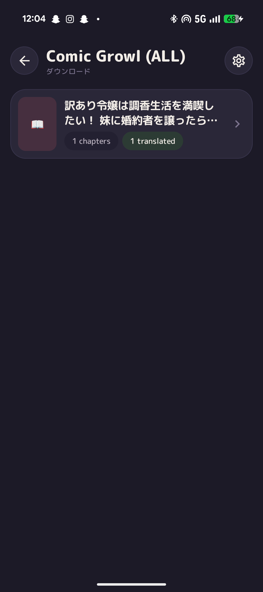
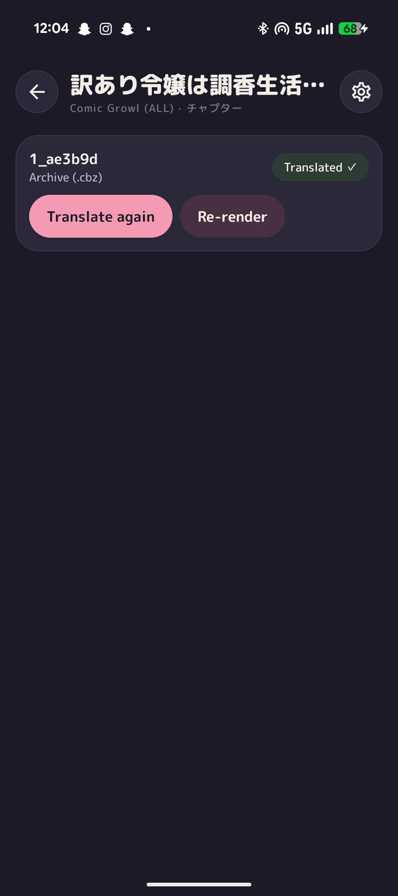
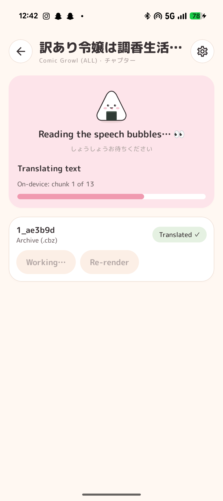
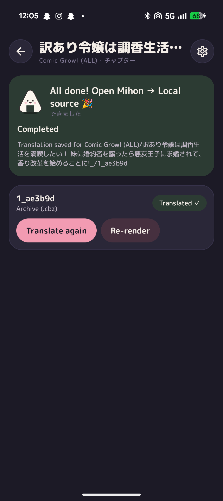
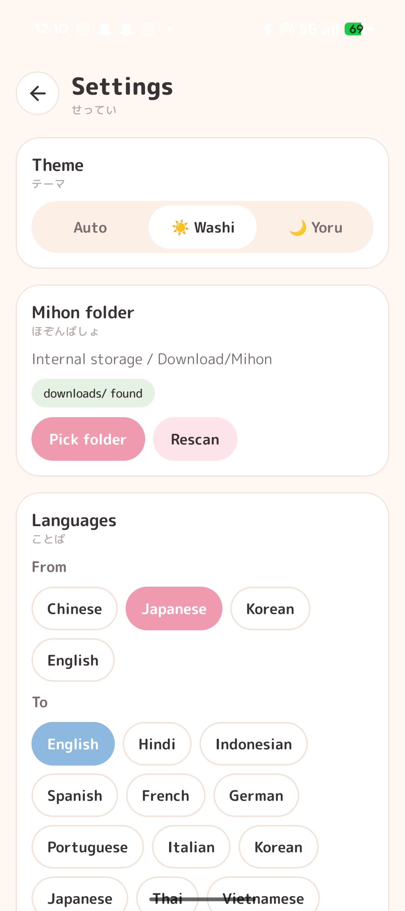
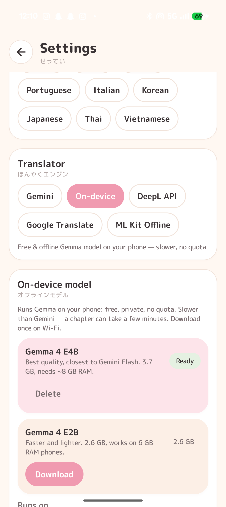
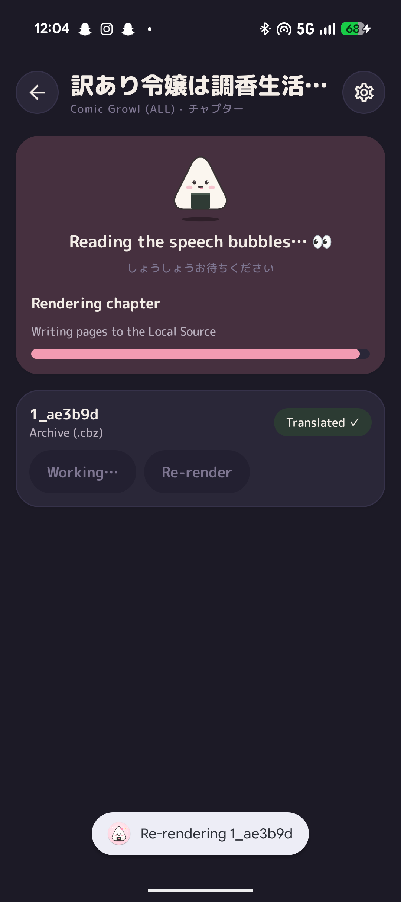
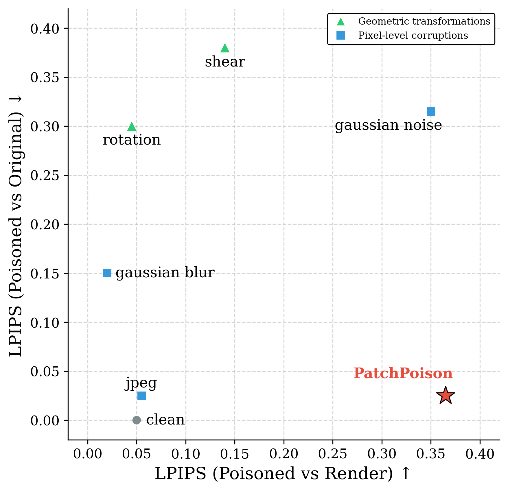

# Honyuka v0.2.0

Honyuka (ほにゅか, a playful mispronunciation of *honyakuya*, "translator") is an Android app that translates the manga chapters you've downloaded in [Mihon](https://mihon.app/) and puts the translated chapter back into Mihon's **Local source**, ready to read.

It reads the text on each page on-device, translates it with the engine you choose — including a **free, offline Gemma model that runs on your phone** — and redraws the translation into the speech bubbles.

## Screenshots

| Manga | Chapter | Translating on-device | Done |
| :---: | :---: | :---: | :---: |
|  |  |  |  |

| Settings | On-device model | Re-rendering |
| :---: | :---: | :---: |
|  |  |  |

Screenshots are from a Pixel 9a, in the light (Washi) and dark (Yoru) themes.

## How it works

```text
Mihon downloads ──► OCR (ML Kit, on-device) ──► translate ──► redraw bubbles ──► Mihon Local source
downloads/…/<chapter>.cbz        text + boxes      Gemini / Gemma /     erase + fit text    local/<manga> (Honyuka)/<chapter>.cbz
                                                   DeepL / Google / ML Kit
```

1. **Read the page.** ML Kit finds the text and its position on every page. Vertical Japanese columns are read right-to-left, and nearby lines in the same bubble are merged.
2. **Translate.** Only lines that still need a translation are sent. Repeated lines are sent once, and lines seen in earlier chapters come from a translation memory on the phone. Progress is saved after every batch, so an interrupted run picks up where it stopped.
3. **Redraw.** The original text is erased, the translation is fitted into the bubble (font size scales with the page, long words hyphenate), and pages are saved in their original format.
4. **Hand back to Mihon.** The chapter is written to `local/<manga> (Honyuka)/<chapter>.cbz` with a rewritten `ComicInfo.xml` and a cover, so Mihon shows it as its own manga.

## How to use

1. **Download chapters in Mihon** as usual.
2. **Open Honyuka → ⚙️ Settings → Mihon folder** and pick the folder Mihon stores its data in (the one containing `downloads/`, e.g. `Download/Mihon`).
3. **Choose a translator** (see below). For the on-device model, tap **Download** once, on Wi-Fi.
4. **Open a manga → Translate** on a chapter. You can leave the app; a notification shows progress.
5. **In Mihon, open Browse → Local source** and pull to refresh. The translated copy appears as "*<manga> (Honyuka)*".

**Re-render** redraws a translated chapter from the saved text without translating again (handy after layout fixes). **Translate again** only translates lines that are still missing.

## Translators

| Translator | Cost | Internet | Speed | Notes |
| --- | --- | --- | --- | --- |
| **On-device (Gemma)** | Free | Only to download the model | Slow (see below) | Private, no quota. Best quality you can get offline. |
| **Gemini** | Free tier / paid | Yes | Fast (~1 request per chapter) | Best quality. Needs an API key. |
| **DeepL** | Free tier / paid | Yes | Fast | Needs an API key. |
| **Google Translate** | Free | Yes | Fast | Lower quality, no key. |
| **ML Kit** | Free | Only once | Fast | Offline, lowest quality. |

### On-device models

Runs Google's [Gemma 4](https://huggingface.co/litert-community) through [LiteRT-LM](https://github.com/google-ai-edge/LiteRT-LM). Pick one in **Settings → On-device model**:

| Model | Download | RAM | Quality |
| --- | --- | --- | --- |
| **Gemma 4 E4B** | 3.7 GB | ~8 GB | Closest to Gemini Flash |
| **Gemma 4 E2B** | 2.6 GB | 6 GB | Faster, a bit weaker |

**Speed depends heavily on the phone.** On a Pixel 9a (Tensor G4) the model runs on the CPU and a 30-page chapter takes over an hour with E4B. Phones whose GPU LiteRT supports are many times faster. Start a chapter and let it run in the background — progress is saved after every batch, and finished lines are never translated twice.

**Runs on: Auto / GPU / CPU.** Auto tries the GPU first. Some GPU drivers crash while the model loads; Honyuka notices that and uses the CPU from then on.

### Keeping Gemini usage low

- Only untranslated lines are sent; translating a chapter again sends nothing.
- Repeated lines are sent once; lines from earlier chapters come from the translation memory.
- Most chapters fit in a single request, and model "thinking" is turned down to the minimum (thinking tokens are billed).
- The default model is `gemini-flash-lite-latest` (largest free quota). **Refresh models** lists every model your key can use.

## Folder layout

Pick the same root folder Mihon uses:

```text
<Mihon folder>/
  downloads/<source>/<manga>/<chapter>.cbz     ← read (never modified)
  translations/<source>/<manga>/<chapter>.json ← saved OCR text + translations
  local/<manga> (Honyuka)/
    ComicInfo.xml                              ← Series = "<manga> (Honyuka)"
    cover.jpg                                  ← first page, written once
    <chapter>.cbz                              ← translated pages + ComicInfo.xml
```

In-progress Mihon downloads (`*_tmp`) are skipped. Deleting a chapter's `.json` makes Honyuka read its pages again on the next translate.

## Evaluation

<p align="center">
  
</p>

LPIPS (perceptual distance) of **PatchPoison** compared with common image corruptions (JPEG, Gaussian blur, Gaussian noise, rotation, shear). X axis: LPIPS between the poisoned image and its render (higher is better). Y axis: LPIPS between the poisoned image and the original (lower is better, i.e. less visible). Vector versions: [SVG](docs/plots/lpips_evaluation_plot_clean.svg) · [PDF](docs/plots/lpips_evaluation_plot_clean.pdf).

## Settings

- **Theme:** Auto, ☀️ Washi (light) or 🌙 Yoru (dark).
- **Mihon folder:** the root that contains `downloads/`.
- **Languages:** from Japanese, Korean, Chinese or English, into 12 languages.
- **Translator** and its options (model, API key, on-device model and backend).

## Build

Requires the Android SDK and JDK 17.

```powershell
.\gradlew.bat assembleRelease          # APK → build/outputs/apk/release/Honyuka-release.apk
adb install -r build\outputs\apk\release\Honyuka-release.apk
```

Kotlin 2.4 · Jetpack Compose · ML Kit text recognition · LiteRT-LM 0.18 · minSdk 26 · arm64.
